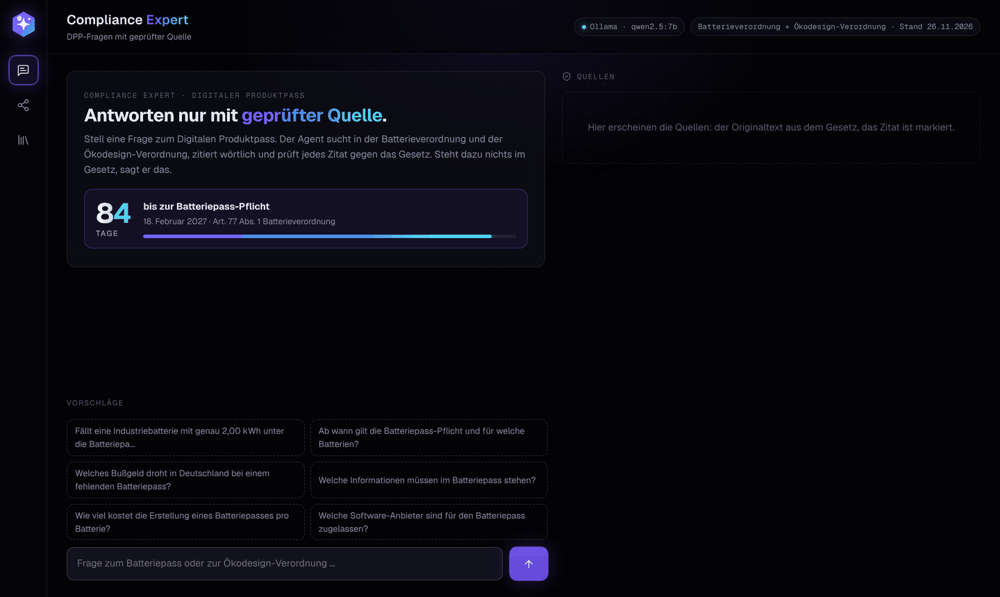
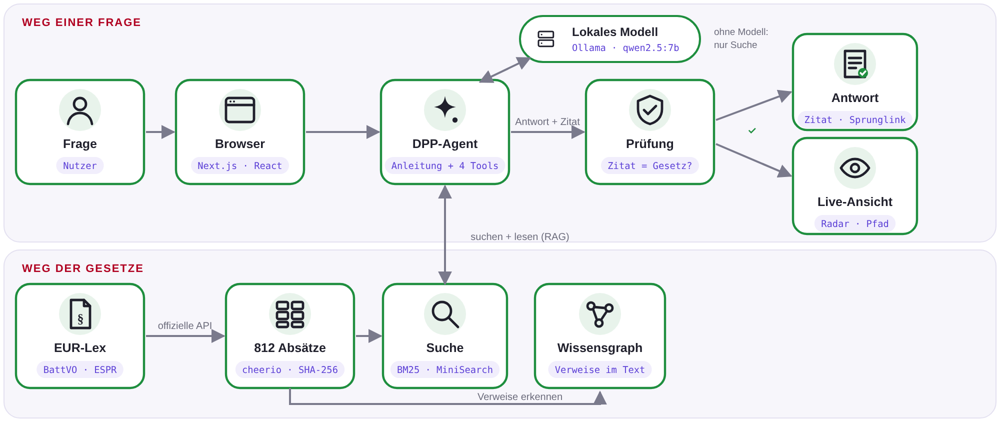
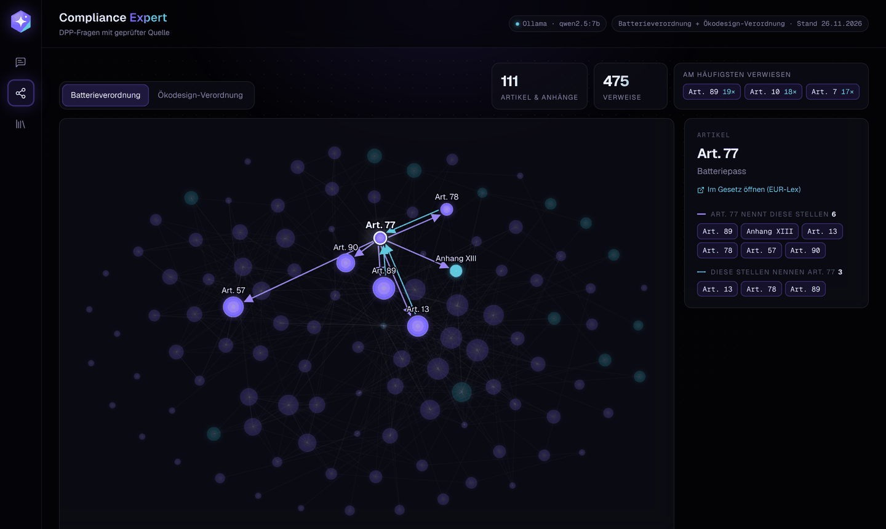
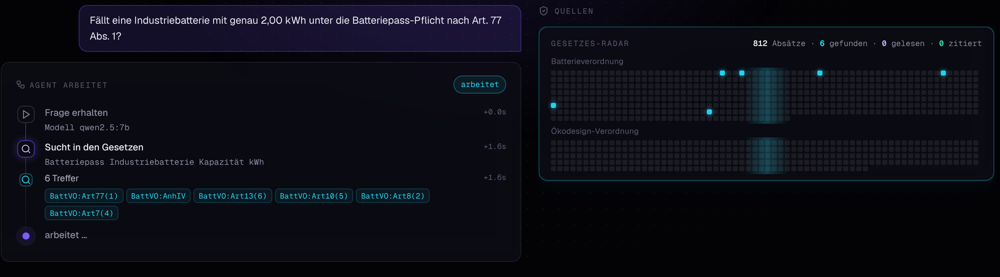
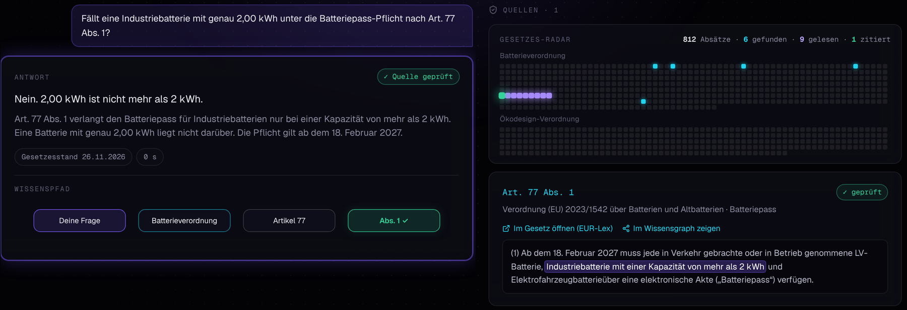
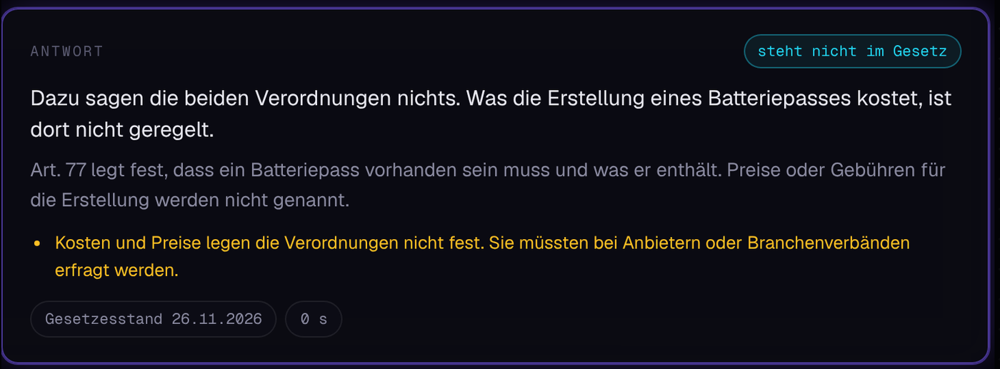
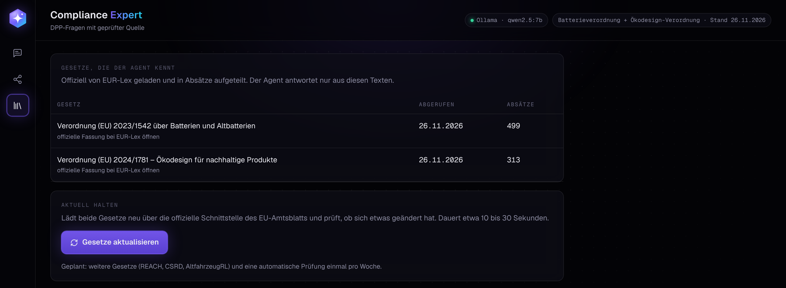
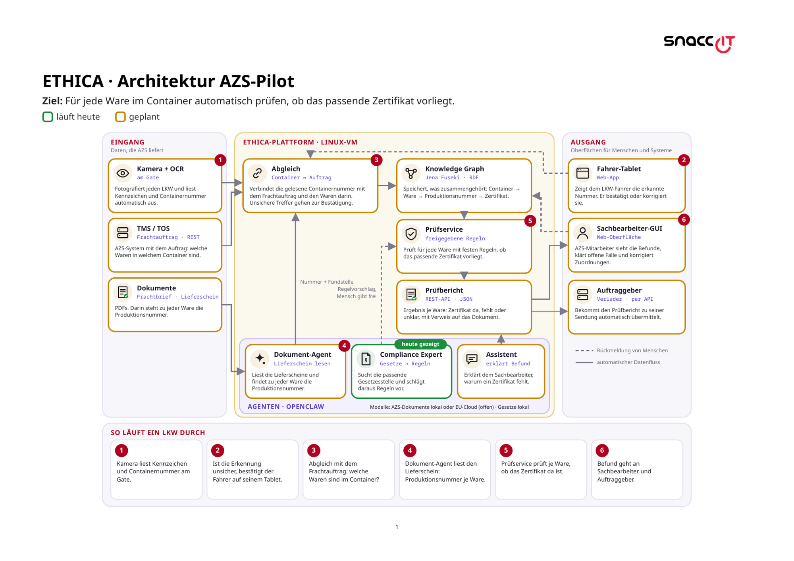

<div align="center">

<a href="https://www.snacc-it.de">
  <picture>
    <source media="(prefers-color-scheme: dark)" srcset="https://www.snacc-it.de/logo-snaccit-white.svg">
    
  </picture>
</a>

# Compliance Expert

Fragen zum Digitalen Produktpass, beantwortet mit geprüften Zitaten aus dem Gesetz.

[](LICENSE)


</div>



Der Compliance Expert ist ein Prototyp, den snacc-it im Forschungsprojekt ETHICA umgesetzt hat. Er beantwortet Fragen zur Batterieverordnung (EU) 2023/1542 und zur Ökodesign-Verordnung (EU) 2024/1781. Jede Antwort stützt sich auf wörtliche Zitate, die der Server gegen den Originaltext prüft. Steht etwas nicht im Gesetz, sagt die Anwendung das, statt eine Antwort zu erfinden.

Das Sprachmodell läuft lokal, ein API-Key wird nicht benötigt.

> Forschungsprototyp, keine Rechtsberatung.

## Funktionsweise



Die Anwendung trennt zwei Aufgaben: Das Sprachmodell sucht und formuliert, der Server prüft. Ob ein Zitat im Gesetz steht, entscheidet nie das Modell.

### Aufbereitung

`npm run ingest` lädt die Verordnungen über die Cellar-Schnittstelle des EU-Amtsblatts, bei Bedarf über EUR-Lex. Ein Parser zerlegt den Text in Rechtseinheiten: ein Absatz eines Artikels oder eine Nummer eines Anhangs, mit stabiler Kennung wie `BattVO:Art77(1)`. Lange Einheiten werden bei 3.500 Zeichen an Zeilengrenzen geteilt. Aktuell entstehen so 812 Einheiten. Zu jedem Gesetz speichert die Registry einen SHA-256-Fingerabdruck über den zerlegten Text, sodass Änderungen beim nächsten Abruf auffallen.

### Suche

Die Suche ist bewusst klassisch: BM25 über MiniSearch, im Speicher gehalten und bei Änderungen der Daten neu aufgebaut. Überschrift (Gewicht 2,5) und Fundort (Gewicht 2) zählen stärker als der Fließtext, dazu kommen Präfix- und Fuzzy-Suche sowie eine deutsche Stoppwortliste. Verweise wie „Art. 77 Abs. 1“ oder „Anhang XIII“ werden vorab erkannt und stehen vor den Suchtreffern. Ein Gesetz lässt sich über Stichwörter in der Frage (etwa „Batterie“ oder „Ökodesign“) eingrenzen.

Es gibt keine Embeddings und keine Vektordatenbank. Rechtsbegriffe und Fundstellen lassen sich lexikalisch zuverlässig finden, ein zusätzliches Modell wäre nicht nötig und schwerer nachzuvollziehen. Die Kehrseite: Synonyme, die im Gesetzestext nicht vorkommen, findet die Suche schlechter. Das gleicht der Agent teilweise aus, indem er mit anderen Begriffen erneut sucht.

### Agent

Das Modell arbeitet in einer Schleife mit höchstens fünf Schritten und vier Werkzeugen:

| Werkzeug | Aufgabe |
| --- | --- |
| `suche_rechtstext` | Volltextsuche, liefert Kennungen, Fundort und Textanfang |
| `lese_einheit` | Liest eine Einheit; mit einer Artikelkennung wie `BattVO:Art77` alle Absätze des Artikels |
| `pruefe_zitat` | Prüft vorab, ob ein Zitat in einer Einheit steht |
| `antwort_geben` | Beendet die Schleife mit einer strukturierten Antwort |

Der Prompt begrenzt die Arbeit auf höchstens zwei Suchen. Findet der Agent keine Vorschrift, die die Frage regelt, soll er mit `keine_quelle` antworten, statt Absätze zu zitieren, die nur ähnlich klingen. Im letzten Schritt erzwingt der Server die Antwort über ein JSON-Schema (Felder: Antwort, Begründung, Fundstellen mit Zitat, Stichtag, Sicherheit, Lücken). Modelle, die Werkzeugaufrufe als Text statt über die Tool-API ausgeben, werden ebenfalls verstanden.

### Zitatprüfung

Jede Fundstelle des Modells besteht aus einer Kennung und einem wörtlichen Zitat. Der Server sucht das Zitat im Originaltext der Einheit. Dabei werden Leerraum ignoriert (EUR-Lex-Texte enthalten fehlende und doppelte Leerzeichen) sowie Anführungszeichen und Gedankenstriche vereinheitlicht. Auslassungen mit „…“ sind erlaubt, wenn die Teile in der richtigen Reihenfolge stehen. Steht das Zitat in einem Nachbarabsatz desselben Artikels und ist dort eindeutig, wird die Kennung korrigiert. Das Ergebnis ist einer von fünf Zuständen:

- **belegt:** alle Zitate stehen im Gesetz
- **teilweise belegt:** nur ein Teil der Zitate
- **nicht belegt:** kein Zitat passt zum Text
- **keine Quelle:** das Gesetz regelt die Frage nicht
- **nur Suche:** kein Modell erreichbar, es werden nur Treffer gezeigt

Verifizierte Zitate erhalten einen Link in den EUR-Lex-Text, der per Textfragment (`#…:~:text=`) direkt an die zitierte Stelle springt.

### Sprachmodell

Standard ist Ollama mit `qwen2.5:7b`. Alternativ funktioniert jeder OpenAI-kompatible Server, etwa LM Studio, über `LLM_PROVIDER=openai` und `LLM_BASE_URL`. Das Modell muss Tool Calling beherrschen. Ist kein Modell erreichbar, wechselt die Anwendung in den Suchmodus. Antworten werden standardmäßig nicht zwischengespeichert (`ANSWER_CACHE=on` schaltet das ein).

### Wissensgraph

Aus den Rechtseinheiten wird ein Graph gebaut: Artikel und Anhänge sind Knoten, Verweise im Text („gemäß Artikel 13 Absatz 6“, „Artikel 5 bis 10“) sind Kanten. Verweise auf andere Rechtsakte werden erkannt und ausgelassen. Der Graph entsteht automatisch beim Laden und braucht keine Pflege.



### Qualitätssicherung

`npm run eval` stellt die Fragen aus `evals/questions.yaml` und prüft pro Frage, ob erwartete Begriffe genannt, die richtige Fundstelle zitiert oder, bei Fragen ohne Rechtsgrundlage, korrekt verweigert wird. `npm test` deckt Parser, Zitatprüfung, Antwortlogik, Fingerabdruck und Werkzeugaufrufe ab.

## Oberfläche

Die Seite „Fragen“ zeigt die Arbeit des Agenten live: Jeder Suchschritt erscheint sofort, und das Gesetzes-Radar färbt alle 812 Absätze nach „gefunden“, „gelesen“ und „zitiert“.



Am Ende steht die Antwort mit Status, Wissenspfad und dem Zitat im Gesetzestext. „Im Gesetz öffnen“ springt an dieselbe Stelle bei EUR-Lex.



Regelt das Gesetz die Frage nicht, sagt die Anwendung das und zitiert nichts Ähnliches.



Die Seite „Gesetze“ zeigt, welche Texte geladen sind, und lädt sie auf Knopfdruck neu.



*Die Bilder zeigen die Oberfläche mit einer aufgezeichneten Beispielantwort, daher sind Zeitangaben nicht aussagekräftig.*

## Einordnung in ETHICA

Im Pilot mit AZS soll für jede Ware im Container automatisch geprüft werden, ob das passende Zertifikat vorliegt. Der Compliance Expert liefert dafür die Gesetzesstelle und schlägt daraus Regeln vor, die ein Mensch freigibt. Grün ist, was heute läuft, gelb ist geplant.



## Installation

Benötigt werden [Node.js](https://nodejs.org) ab 20.12 und [Ollama](https://ollama.com).

```bash
ollama pull qwen2.5:7b

git clone https://github.com/snaccit/ethica-compliance-expert.git
cd ethica-compliance-expert
npm install
npm run dev
```

Die Anwendung läuft danach unter <http://localhost:3000>. Die Gesetzestexte sind bereits enthalten. Ohne laufendes Modell zeigt die Anwendung nur Suchtreffer.

Andere Modelle oder LM Studio lassen sich über `.env.local` einstellen, siehe `.env.example`. Größere Modelle liefern spürbar bessere Antworten; das Modell muss Tool Calling unterstützen.

## Befehle

```bash
npm run dev       # starten
npm run ingest    # Gesetzestexte neu laden
npm run eval      # Testfragen auswerten
npm test          # Tests
```

## Grenzen

- Enthalten sind bisher nur zwei EU-Verordnungen, nationales Recht fehlt.
- Die Zitatprüfung schließt erfundene Quellen aus, aber keine falsche Auslegung.

## Lizenz

Code unter [MIT-Lizenz](LICENSE). Gesetzestexte in `data/`: © Europäische Union, [EUR-Lex](https://eur-lex.europa.eu), Weiterverwendung gemäß Beschluss 2011/833/EU. Verbindlich ist nur die im Amtsblatt veröffentlichte Fassung.
